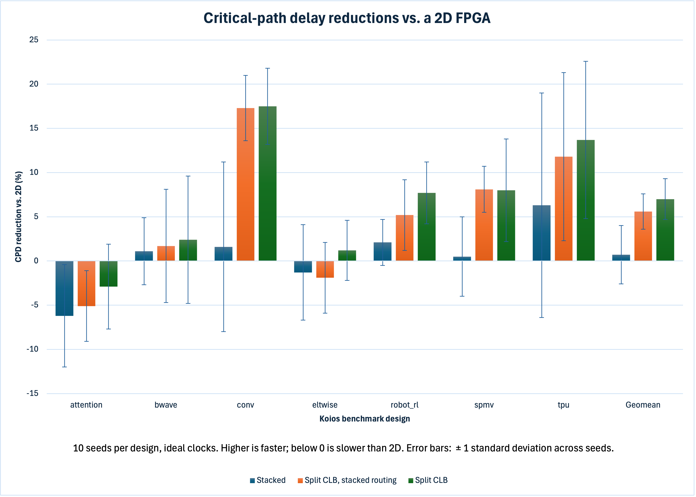

# Split 3D CLB: one FPGA logic block across two layers

**Ryu Tran** · Georgia Tech (SHARC Lab)

Published 3D FPGA architectures keep each logic block (CLB) whole and stack whole blocks on top of each other.
This project splits **one** CLB across two bonded layers: a 20-LUT CLB with 10 LUTs and a small
crossbar on each layer, and signals that cross between the layers *inside* the CLB. To make that
possible, I extended **VTR/VPR**, **OpenFPGA** and **LaZagna** so that a CLB can span layers, with
each LUT and each pin on a chosen layer, then measured it against LaZagna's stacked 3D CLBs and a
2D FPGA.

**Why it helps.** A 20-LUT CLB is no faster than a 10-LUT one in 2D, because its crossbar grows
with the square of its size. Split 10 + 10, each layer's crossbar stays small, and the bigger
cluster means fewer trips between CLBs on the slowest paths.

## Highlights

- **7.1% lower critical-path delay than a 2D FPGA, and 6.4% lower than LaZagna's stacked 3D CLBs**
  on 7 Koios deep-learning designs with RAM and DSP blocks (10 seeds each, sky130 delays, ideal clocks).
- **The gain comes from the CLB.** On identical 3D routing, the split CLB alone is 5% faster than
  stacked (3.2% with routed clocks); 3D routing alone (2D to stacked) gives 0.7% (2.4% routed).
- **Not from extra routing.** The split fabric is routed with more tracks than stacked, but giving
  stacked the same tracks doesn't speed it up (0.994x ideal, 1.002x routed), and at equal tracks the
  split is still 5.9% faster (ideal clocks, 7/7 designs; 5.8% routed).
- **Shrinks when layer crossings are slower.** With every crossing (in the CLB and in the routing)
  slowed to the layout's 1.5x and 2.2x the SPICE value, the split is 3.2% and 1.5% faster than
  stacked (ideal clocks; 4.4% and 2.7% routed).
- **Real hardware:** the split CLB's generated Verilog is laid out in sky130 with 0 DRC errors and
  passes gate-level equivalence against the original CLB.
- **VTR support for CLBs that span layers** (`layer_span`, `instance_layer_offsets`, `pin_layer`,
  `layer_crossing_delay`), with crossings inside the CLB charged in timing, and OpenFPGA/LaZagna
  generating one Verilog module per layer.

## Results

<p align="center"></p>

The chart averages each design's 10 runs with a geometric mean (split CLB 7.0%); the tables below
use the plain average of each design's runs (7.1%).

Every number below comes from a results file named next to it. Ratios are critical-path delay
(CPD) of one fabric over another, geometric mean over designs; **lower is faster**. Koios runs:
7 designs, 10 seeds each, RAM/DSP in per-layer columns. "Ideal clocks" assumes no clock skew;
"routed clocks" also sends the clock over the general routing.

### Split CLB vs LaZagna's stacked CLBs

| Comparison | Ideal clocks | Routed clocks | File |
|---|---|---|---|
| Split over stacked | **0.936**, faster on 7/7 | **0.944**, 5/7 | [ideal_table.txt](prototype/lazagna/hardblocks/results/seeds10/ideal_table.txt), [route_table.txt](prototype/lazagna/hardblocks/results/seeds10/route_table.txt) |
| Ablation: same routing as stacked, only the CLB changes | **0.950**, 6/7 | **0.968**, 4/6 | [ablation_table.txt](prototype/lazagna/hardblocks/results/seeds10/ablation/ablation_table.txt) |
| Equal tracks: stacked given the split's track count | **0.941**, 7/7 | **0.942**, 5/7 | [equal_tracks_table.txt](prototype/lazagna/hardblocks/results/seeds10/equal_tracks/equal_tracks_table.txt) |
| Every crossing 1.49x slower (in-CLB at the layout's 504 ps; SPICE: 339 ps) | 0.968, 5/7 | 0.956, 5/7 | [crossings_table.txt](prototype/lazagna/hardblocks/results/seeds10/crossings/crossings_table.txt) |
| Every crossing 2.24x slower (in-CLB at the layout's 760 ps) | 0.985, 4/7 | 0.973, 4/7 | same |

"4/6" or "5/6": one run of 70 did not route, and that design is left out of the ratio. In the
crossing rows a failed run drops only that seed (two runs at 1.49x, ideal clocks).

### Against a 2D FPGA (10-LUT CLBs, the fastest 2D size with these delays)

| Fabric over 2D | Ideal clocks | Routed clocks | Min. tracks per layer |
|---|---|---|---|
| Stacked CLBs (3D routing only) | 0.993, 5/7 | 0.976, 5/7 | 0.789 |
| Split CLB | **0.929**, 6/7 | **0.921**, 6/7 | 1.042 |

Both 3D fabrics use 0.509 of the 2D footprint and 1.018 of its die area (grid cells times layers).
Files: [ideal_table.txt](prototype/lazagna/hardblocks/results/seeds10/ideal_table.txt), [route_table.txt](prototype/lazagna/hardblocks/results/seeds10/route_table.txt).

### Other benchmarks (split over stacked, 10 seeds)

| Benchmarks | sky130 | 7 nm (ASAP7) |
|---|---|---|
| 7 bigger VTR designs | 0.971, 4/7 | 0.963, 6/7 |
| 16 small MCNC designs | 1.008 | 0.999 |

File: [SPICE_RESULTS.md](prototype/lazagna/spice/SPICE_RESULTS.md). Small designs gain nothing.

### Layout

- Area as laid out (own-layer pins, 66 tracks): 1.036 of 2D's silicon per LUT and 0.518 of its
  footprint per LUT ([tile_results_relaxed_tracks.txt](prototype/lazagna/pnr/tile_results_relaxed_tracks.txt)).
- Gate-level equivalence: random inputs compared with the original CLB every cycle, and cutting a
  used layer crossing makes it fail ([direct_crossing_results.txt](prototype/lazagna/pnr/direct_crossing_results.txt), [ff_test/](prototype/lazagna/ff_test)).

## What I built

### Architecture file

```xml
<tile name="clb" layer_span="2">                            <!-- the CLB occupies 2 layers -->
<loc side="left" pin_layer="1">...</loc>                    <!-- pins on the upper layer -->
<loc side="left" pin_layer="0" layer_offset="1">...</loc>   <!-- pins that also reach the layer above -->
<pb_type name="fle" num_pb="20"
         instance_layer_offsets="0 0 0 0 0 0 0 0 0 0 1 1 1 1 1 1 1 1 1 1">  <!-- layer of each LUT -->
<complete name="crossbar0" input="clb.I0 fle[19:0].out" output="fle[9:0].in"
          layer_crossing_delay="339.23e-12">                <!-- delay per layer crossed -->
<direct ... layer_offset="1" placement_macro="false"/>      <!-- a direct link to another layer -->
```

Each change stays in the section of the architecture file whose job it is:

| Section | What it describes | What changed |
|---|---|---|
| `<layout>` | where each block sits on the grid | nothing new: the cell above a spanning CLB is left `EMPTY`, and VPR reserves it |
| `<models>` | the primitives' interfaces (for packing) | nothing: LUTs, flip-flops, RAM and DSP are unchanged |
| `<tiles>` | each block's size and pins (for routing) | `layer_span` (next to the existing `width`/`height`), `pin_layer` on `<loc>` |
| `<complexblocklist>` | what is inside a block and its timing | `instance_layer_offsets`, `layer_crossing_delay`, one crossbar per layer |
| `<directlist>` | fixed links between blocks | `layer_offset`, `placement_macro` |
| `<device>`, `<segmentlist>`, `<switchlist>` | routing and its timing | no new attributes |

Offsets are relative to the parent block, so a block keeps its internal layout wherever it is
reused. VPR never stores absolute layers in the shared CLB graph; it adds the placed CLB's anchor
layer when needed.

### Tools

Full list with every function: [TECHNICAL_MAP.md](prototype/lazagna/TECHNICAL_MAP.md), section 1.

- **VTR/VPR** (this repository, on top of VTR `5abd3acaa`, the version LaZagna pins): new
  [`pb_type_layers.cpp`](libs/libarchfpga/src/pb_type_layers.cpp) (each LUT's layer, span checks,
  crossing delays) and [`layer_report.cpp`](vpr/src/base/layer_report.cpp) (per-layer report after
  routing), two new test files, and changes across architecture reading, the device grid,
  placement, the routing graph (each pin on its own layer), the router lookahead and the placement
  delay model. Also available as patches in [`prototype/lazagna/`](prototype/lazagna).
- **OpenFPGA** ([openfpga-lazagna.patch](prototype/lazagna/openfpga-lazagna.patch), 21 files):
  labels every LUT, crossbar mux, configuration bit and wire with its layer in the generated Verilog.
- **LaZagna** ([lazagna-3d-clb-branch.patch](prototype/lazagna/lazagna-3d-clb-branch.patch)): a
  `clb_3d: split_layers: true` setup option, and `split_clb_layers.py`, which cuts each CLB's
  Verilog into one module per layer.
- **Experiment flow** ([prototype/lazagna/](prototype/lazagna)): `compare_2d_3d.py` (builds each
  fabric's architecture, runs VPR per design and seed), `compare_configs.py` (ratios),
  `spice/make_spice.py` (transistor-level delays in Spectre, sky130 and ASAP7), `pnr/` (layout and
  timing), `ff_test/` (hardware equivalence checks), `hardblocks.py` (RAM/DSP placement study).

## How the numbers are made

1. **SPICE.** `spice/make_spice.py` builds transistor-level copies of OpenFPGA's circuits (muxes,
   LUT, buffers, RC wires, and the layer crossing: driver, bond, receiver) for each fabric and
   times them in Spectre. Output: one delay per part.
2. **Architecture and VPR.** `compare_2d_3d.py` writes those delays into each fabric's
   architecture file, picks the smallest square grid that fits the design (LUTs at 70%, RAM/DSP
   at 80%, the same rule for every fabric), finds the minimum tracks, then routes at 1.3x that.
3. **Results.** VPR reports each run's critical path; `compare_configs.py` turns the CSVs into
   ratios.

Recompute the headline from the committed CSVs:

```bash
cd prototype/lazagna
S=hardblocks/results/seeds10
python3 compare_configs.py $S/ideal/stack/results_columns.csv:3d split=$S/ideal/split/results_columns.csv:3d
python3 compare_configs.py $S/ideal/stack/results_columns.csv:3d ablation=$S/ablation/strict_ideal/results_columns.csv:3d
```

## Build

Tested from a fresh clone on macOS (Apple Silicon, Homebrew `cmake bison flex openssl@3 python`):

```bash
git clone https://github.com/goshoryuken/split-3d-clb.git
cd split-3d-clb
git submodule update --init libs/EXTERNAL/libcatch2
cmake -S prototype -B build/vpr -DCMAKE_BUILD_TYPE=Release -DPROTOTYPE_BUILD_VPR=ON \
      -DOPENSSL_ROOT_DIR=/opt/homebrew/opt/openssl@3 \
      -DBISON_EXECUTABLE=/opt/homebrew/opt/bison/bin/bison \
      -DFLEX_EXECUTABLE=/opt/homebrew/opt/flex/bin/flex \
      -DCMAKE_POLICY_VERSION_MINIMUM=3.5
make -C build/vpr -j6 vpr
```

On macOS the Homebrew bison and flex are needed (the system bison is too old). On Linux, drop the four Homebrew paths. The experiment scripts need only Python 3 (standard library).

## Reproduce

After the build, from the repository root:

```bash
QUICK=1 prototype/lazagna/reproduce_koios.sh out-quick   # spmv, seed 1: a few minutes
prototype/lazagna/reproduce_koios.sh out                 # all 7 designs x 10 seeds
ABLATION=1 prototype/lazagna/reproduce_koios.sh out      # also the split CLB on stacked's routing
```

The script runs 2D, stacked and split fabrics with routed clocks, then ideal clocks at the same
track counts, and prints the same ratios as
[ideal_table.txt](prototype/lazagna/hardblocks/results/seeds10/ideal_table.txt). `JOBS` sets the
parallel VPR runs per 3D fabric (default 4); each run needs about 1.5 GB of memory, and the full
sweep (about 420 VPR runs) took about 1 h 20 min with 12 runs at a time on an Apple Silicon Mac.

- **Netlists:** the 7 Koios designs are in
  [`hardblocks/koios/`](prototype/lazagna/hardblocks/koios), synthesized from VTR's Koios Verilog
  with [`synth_koios.sh`](prototype/lazagna/hardblocks/synth_koios.sh) (regenerating them needs
  Yosys).
- **Delays:** the SPICE delay sets are committed
  ([`spice/delays_tt_all.json`](prototype/lazagna/spice/delays_tt_all.json)), so reruns need no
  SPICE. Re-deriving them needs Cadence Spectre and the sky130 PDK; the layout needs Innovus and a
  sky130 RTL-to-GDS flow. Neither is included.
- **Records:** the `run_*.sh` scripts next to each result record how it was made (with the folders
  they ran in).

## Limitations

- **The gain depends on the design.** In the ablation, conv_layer is 16% faster than stacked
  and one design (two with routed clocks) is slightly slower; without conv_layer the CLB-only gain is 3% (ideal clocks)
  and 1% (routed). Small designs gain nothing.
- **These are VPR timing results** with delays from SPICE models of OpenFPGA's circuits, not
  measurements of a fabricated chip. RAM and DSP delays are estimated.
- **The split CLB's edge depends on the layer-crossing delay**: its slowest paths cross layers
  about 3.0 times versus 1.1 for stacked, so its edge over stacked shrinks as crossings get slower.
  With every crossing slowed together: 6.4% at the SPICE value, 3.2% at 1.49x and 1.5% at 2.24x
  (ideal clocks); without conv_layer it is a tie at 2.24x.
- With RAM/DSP, the split fabric needs 4.2% more tracks per layer than 2D and 32% more than
  stacked. That is an area cost; it is not where the speed comes from (equal-track rerun above).
- A 40-LUT CLB over 4 layers loses; this works for 2 layers.

## Repository layout

| Path | Contents |
|---|---|
| [`prototype/lazagna/`](prototype/lazagna) | Experiment scripts, patches, results and technical docs |
| [`prototype/lazagna/hardblocks/results/seeds10/`](prototype/lazagna/hardblocks/results/seeds10) | Koios results: headline, ablation, layout crossing, bond pitch |
| [`prototype/lazagna/spice/`](prototype/lazagna/spice) | SPICE generator, delay sets and SPICE results |
| [`prototype/lazagna/pnr/`](prototype/lazagna/pnr) | Layout flow scripts and layout results |
| [`prototype/lazagna/ff_test/`](prototype/lazagna/ff_test) | Hardware equivalence checks |
| `prototype/` (other files) | The first prototype (below) |
| `libs/`, `vpr/` | VTR with the multi-layer CLB changes |
| [`VTR_README.md`](VTR_README.md) | VTR's own README |

Further reading: [TECHNICAL_MAP.md](prototype/lazagna/TECHNICAL_MAP.md) (every code change and
which file backs each number), [HARDBLOCKS.md](prototype/lazagna/HARDBLOCKS.md) (the Koios study
with RAM/DSP), [SPICE_RESULTS.md](prototype/lazagna/spice/SPICE_RESULTS.md),
[LITERATURE.md](prototype/lazagna/LITERATURE.md) (related work).

## First prototype

The idea was first built on a 3D VTR fork: one 10-LUT CLB with 5 LUTs on each layer, packed,
placed, routed and timed by VPR, with OpenFPGA tagging each LUT's layer in the generated Verilog
and the configured fabric checked in simulation. Its files are in `prototype/`:
`physical_split_fle.xml` and `openfpga_split_fle.xml` (architectures), the `ten_luts*` and
`asymmetric_ten_luts*` test circuits, and `test_physical_layers.py` (24-case VPR suite),
`test_mapped_rtl.py` and `run_openfpga_demo.py` (post-route and configured-fabric simulation).

## Built on

[VTR](https://github.com/verilog-to-routing/vtr-verilog-to-routing),
[OpenFPGA](https://github.com/lnis-uofu/OpenFPGA) and
[LaZagna](https://github.com/sharc-lab/LaZagna) (Youssef, Yang and Hao, ICCAD 2025); benchmarks
from Koios, VTR and MCNC; the SkyWater sky130 and ASAP7 process kits. Their licenses and
generated-file headers are kept; VTR's license is in [LICENSE.md](LICENSE.md).
